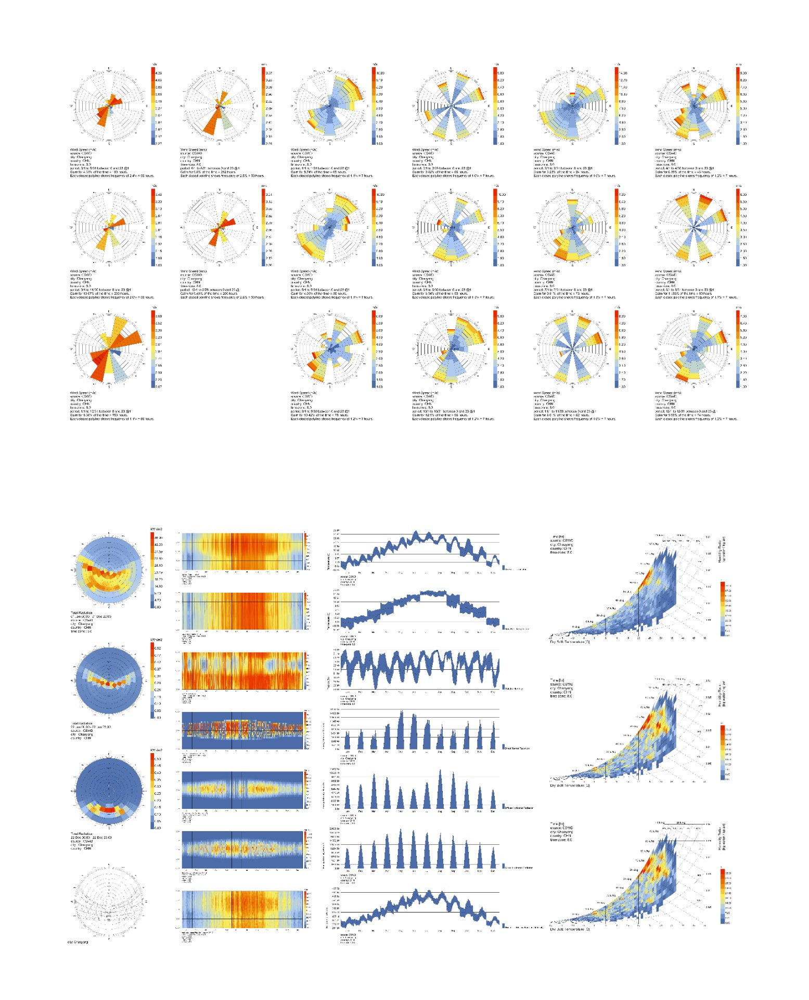

# climate-atlas · 气候分析图集生成器

> 一份 `.epw` + 一个建筑模型 → 一整套气候分析图：风玫瑰、太阳轨迹、逐时热图、月度图表、三维频次曲面、含遮挡的场地日照专题。
> 是 Ladybug「Climate Analysis」那张一图出全集的**可复现拆解**：把六类图式拆开，逐类重画。

只依赖 `numpy + matplotlib`，不需要 Ladybug Tools。
需要与 Ladybug Tools 生态环境逐位对齐时，加 `--engine ladybug` 走官方 `ladybug`。



---

## 它解决什么问题

做建筑前期分析时，气候图通常是这样产生的：在 Grasshopper 里拖一堆 Ladybug 电池，
调参数、截图、拼版——**换一个场地或换一版模型就得重来一遍**，而且电池组不可 diff、不可复用。

这个项目把整条链路固化成脚本：

1. **读 EPW**：原生解析（零依赖），或走 ladybug；
2. **反解模型朝向**：外部证据交叉验证，不靠猜；
3. **含遮挡日照引擎**：三角面 → 高度场 → 沿太阳方向采样；
4. **按六类图式出图**：每类一个脚本，产物按类型分目录。

复现一次图集 = 一条命令。

---

## 快速开始

```bash
git clone <this-repo> && cd climate-atlas
pip install -r requirements.txt

cp atlas.example.json atlas.json
# 改 atlas.json：epw / mesh / orientation / site
python scripts/atlas_config.py       # 自检配置
python scripts/run_all.py           # 出全套图（约 1–2 分钟）
```

产物落在 `图集/` 下，按类型分子目录（`01_极坐标玫瑰`、`06_建筑专题` …）。

只出某几类：

```bash
python scripts/run_all.py --skip-data --only 01,06
```

---

## 目录结构

```
climate-atlas/
├── SKILL.md                    # 给 AI agent 的技能说明（何时用、怎么跑）
├── atlas.example.json          # 配置模板，复制成 atlas.json
├── requirements.txt
├── scripts/
│   ├── atlas_config.py         # ★ 唯一配置入口：路径 + 朝向 + 场地范围
│   ├── epw_native.py           # 零依赖 EPW 读取 + NOAA 太阳位置
│   ├── climate_engine.py       # 朝向换算 / 高度场 / 遮挡判定
│   ├── extract_climate.py      # EPW → climate_data.json（统计量）
│   ├── extract_epw_raw.py      # EPW → epw_hourly.json（逐时原值）
│   ├── run_solar_site.py       # 含遮挡的场地日照网格（最慢的一步）
│   ├── plot_common.py          # 版式与配色（统一视觉语言）
│   ├── plot_00_overview.py     # 总图版（一页交付）
│   ├── plot_01_polar.py        # 极坐标玫瑰族
│   ├── plot_02_05_sun.py       # 太阳轨迹族 + 三维频次曲面族
│   ├── plot_03_04_series.py    # 逐时热图族 + 月度图表族
│   ├── plot_06_building.py     # 建筑专题族（场地日照/阴影矩阵/立面潜力）
│   ├── plot_99_index.py        # 图集总览
│   └── run_all.py              # 一键全流程
├── references/
│   ├── figure-types.md         # 六类图式的拆解与判读
│   ├── orientation.md          # 模型朝向反解（四条证据法）
│   ├── metrics.md              # 指标口径（一个数字只能有一个定义）
│   └── pitfalls.md             # 12 个坑 + 排错顺序
└── assets/
    └── reference_ladybug_climate_analysis.jpg
```

---

## 配置

`atlas.json` 是唯一配置入口（`$ATLAS_CONFIG` → `./atlas.json` → 技能根 → example → 默认值）。

```json
{
  "epw": "weather/site.epw",
  "mesh": "data/building_mesh.json",
  "orientation": { "brg_y": 24.5 },
  "site": { "xmin": 0, "ymin": 0, "xmax": 180, "ymax": 180, "cell": 1.0, "step": 2.0 },
  "viewpoints": { "sunpath": [50.0, 82.0, 1.5] },
  "labels": { "title": "气候分析图集", "site_name": "" }
}
```

**朝向**是唯一口径：真北在模型 XY 内 = `(−sin φ, cos φ)`，`φ = brg_y`。
也接受 `brg_x`、`true_north_in_model:[x,y]`、`world_axes:true`。
怎么反解见 [`references/orientation.md`](references/orientation.md)。

**建筑模型**是三角面 JSON：

```json
{ "units": "m",
  "objects": [{ "name": "b1", "verts": [[0,0,0], ...], "faces": [[0,1,2], ...],
                "bb": [0,0,0,10,10,10] }] }
```

---

## 六类图式

| 类型 | 内容 | 需要几何 |
|---|---|---|
| 00 总图版 | 一页交付（风玫瑰矩阵 + 四列并置） | ✓ |
| 01 极坐标玫瑰 | 全年/逐月/四季风玫瑰、主导风向罗盘、太阳辐射玫瑰 | — |
| 02 太阳轨迹 | 12 个月日弧、观测点遮挡轮廓、天穹着色 | ✓ |
| 03 逐时热图 | 6 参数 × 365 日 × 24 时 | — |
| 04 月度图表 | 温度/辐射/降水/舒适度占比 | — |
| 05 三维频次曲面 | 温度×钟点、温度×风速等 | — |
| 06 建筑专题 | 场地日照率、阴影范围矩阵、立面得热潜力 | ✓ |

**没有建筑模型也能出 9 张图**（01/03/04/05）。

---

## 精度

native 引擎（NOAA 简化算法）与 Ladybug 实测对照（上海 CSWD 583620，8,760 h）：

| 项 | 差异 |
|---|---|
| 太阳高度角 | \|Δ\| max 0.91°，mean 0.18° |
| 太阳方位角 | \|Δ\| max 1.10°，mean 0.24° |
| 「太阳在地平线上」小时 | 4,205 vs 4,221（−0.4%） |
| 场地逐点日照时数 | max 23 h，mean 10.5 h（÷4,221 h ≈ 0.25%） |
| 风/温/辐射统计 | 逐位一致 |

要逐位对齐就用 `--engine ladybug`（需安装 `ladybug`）。

---

## 已知局限

1. 高度场法只判地表点，**不能做逐层窗视点遮挡**；立面只出"朝向加权潜力"。
2. 遮挡轮廓半径默认 210 m，大场地需调大。
3. 云量按 EPW 十分制处理；`cloud_mean_pct` 是百分比，与 ladybug 原始 okta 均值量纲不同。
4. 图上项目名来自 `labels`，换项目记得改。

---

## 数据来源

- 气象：`climate.onebuilding.org` 的 CSWD / IWEC / TMYx `.epw`
- 建筑几何：Rhino / SketchUp / FBX 导出后三角化
- 参考图式：Ladybug Legacy「Climate Analysis」合成图

## License

MIT
